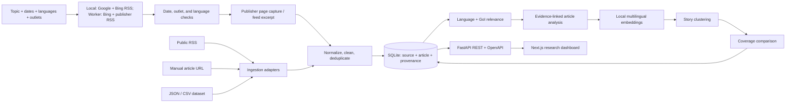

# Architecture

The API keeps online discovery, collection, normalization, language/relevance, analysis, embeddings, clustering, and comparison in separate service modules. `EmbeddingProvider` can be replaced without changing article or API contracts. The default engine is multilingual FastEmbed MiniLM; if its model assets fail to load, a logged deterministic multilingual lexical fallback allows the demo pipeline to finish. Discovery uses public RSS endpoints and does not need an AI model key.

SQLite is the default local persistence layer. Alembic owns the schema revision. The API creates missing tables on startup as a recovery path for direct development runs; the demo launcher applies migrations first.

## Main data path

1. A researcher submits a topic/date/language/source query, dataset upload, RSS feed, or public article URL. Online discovery uses Google News and Bing News RSS; accessible publisher pages are captured, with a labeled feed excerpt fallback.
2. Raw and cleaned text, URL, publication/collection timestamps, language, region, and content hash remain attached to the record.
3. Online articles keep their search-job ID, query, collection method, content kind, and discovery URL. The run analyzes only its newly collected records so the synthetic seed corpus and prior searches retain their clusters.
4. Local analysis and multilingual embeddings are stored with their model labels and confidence/evidence fields.
5. Similar articles form candidate story clusters. The story view derives descriptive language/source comparisons from their stored analyses and includes article IDs for traceability.
6. The frontend reads only the REST API; overview metrics and charts come from database rows.
